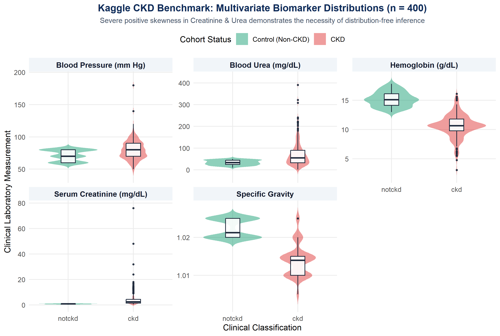
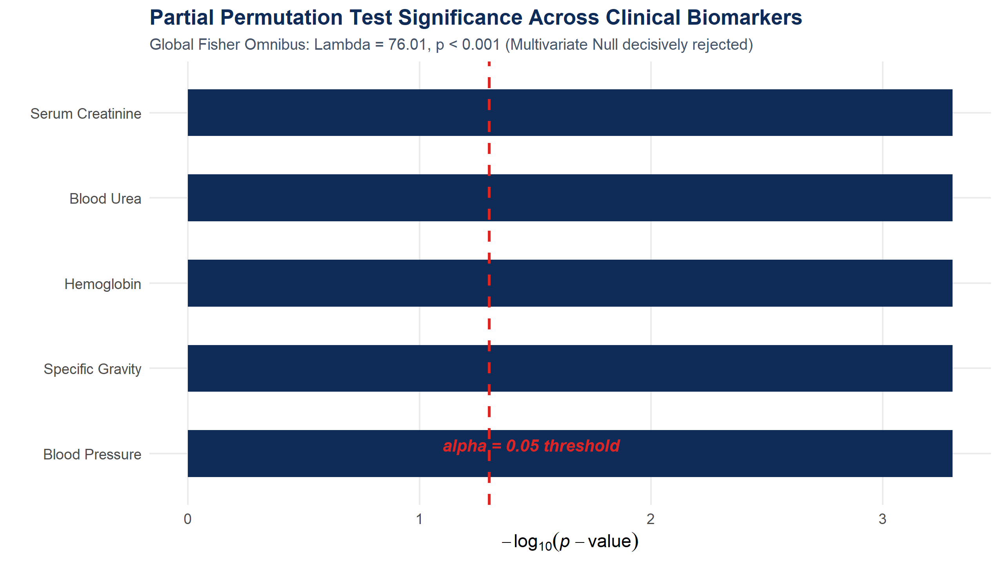
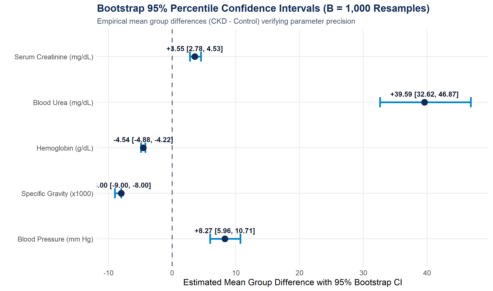

# Non-Parametric Combination (NPC) and Bootstrap Framework for Multivariate Biomarker Inference in Chronic Kidney Disease Diagnosis


[-20BEFF?style=flat-square&logo=kaggle&logoColor=white)](https://www.kaggle.com/datasets/mansoordaku/ckdisease)

## Overview

Chronic Kidney Disease (CKD) is an urgent global public health priority affecting over 800 million individuals worldwide. Early clinical diagnosis and disease staging rely on evaluating multidimensional biochemical and hematological biomarker panels simultaneously rather than isolated tests.

However, classical parametric multivariate techniques (such as MANOVA, Hotelling's $`T^2`$, and ordinary least-squares regression) require strict mathematical assumptions of multivariate Gaussian normality and homogeneity of covariance matrices (homoscedasticity). In real-world biomedical cohorts, these assumptions are routinely violated due to severe positive skewness in renal waste markers (e.g., the standard deviation of serum creatinine in CKD patients is more than 27 times higher than in healthy controls), bounded physiological scales, mixed data types, extreme clinical outliers, and selective laboratory missingness.

This repository implements an end-to-end, **distribution-free biostatistical pipeline in R** that resolves these challenges by combining **Non-Parametric Combination (NPC) permutation testing** ($`B = 2,000`$) with **non-parametric Bootstrap resampling** ($`B = 1,000`$) on the benchmark [Kaggle Chronic Kidney Disease dataset](https://www.kaggle.com/datasets/mansoordaku/ckdisease) ($`n = 400`$).

---

## Repository Structure

```text
ckd-npc-bootstrap-inference/
├── dataset/
│   ├── README.md                             # Dataset link, variable guide & copyright attribution
│   └── kidney_disease.csv                    # Benchmark CKD dataset (n = 400, 25 variables)
├── figures/
│   ├── fig1_biomarker_distributions.png      # Multi-panel violin & boxplot distributions
│   ├── fig2_permutation_significance.png     # Partial permutation -log10(p) bar chart
│   └── fig3_bootstrap_effect_sizes.png       # Forest plot of 95% Bootstrap CIs
├── scripts/
│   ├── ckd_multivariate_npc_bootstrap.R      # End-to-end NPC & Bootstrap analytical pipeline
│   └── test_real_ckd.R                       # Lightweight console verification script
├── .gitignore
└── README.md
```

---

## Mathematical Formulation & Statistical Pipeline

### 1. Group-Stratified Conditional Mean Imputation

To address selective laboratory missingness without attenuating cohort-specific variance or introducing cross-group contamination bias, missing values are imputed conditionally within each diagnostic class $`g \in \{\text{Control}, \text{CKD}\}`$:

```math
x_{ij}^{(\text{imp})} = \begin{cases} x_{ij} & \text{if observed} \\ \bar{x}_{gj} & \text{if missing, for class } g \in \{1, 2\} \end{cases}
```

### 2. Univariate Partial Permutation Testing

Under the global null hypothesis $`H_0: F_1(\mathbf{X}) = F_2(\mathbf{X})`$, observations are exchangeable across cohorts. For each biomarker $`j \in \{1, \dots, k\}`$, the partial null hypothesis $`H_{0j}: F_{1j} = F_{2j}`$is tested against$`H_{1j}: F_{1j} \neq F_{2j}`$across$`B = 2,000`$ Monte Carlo permutations:

```math
p_j = \frac{1}{B} \sum_{b=1}^{B} \mathbb{I}\left(|T_j^{(b)}| \ge |T_j^{(\text{obs})}|\right)
```

### 3. Non-Parametric Combination (NPC) via Fisher's Omnibus Function

To synthesize partial permutation tests into a single global multivariate test while empirically preserving the underlying cross-biomarker correlation structure, partial $`p`$-values are pooled via Fisher's Omnibus combining function:

```math
\Lambda_{\text{obs}} = -2 \sum_{j=1}^{k} \ln(p_j) \sim \chi^2_{2k}
```

### 4. Bootstrap Uncertainty Quantification

To quantify parameter precision without parametric assumptions, cohort mean differences $`\theta_j = \bar{X}_{\text{CKD}, j} - \bar{X}_{\text{Control}, j}`$are resampled with replacement across$`B_{\text{boot}} = 1,000`$ iterations to compute empirical standard errors and 95% percentile confidence intervals:

```math
\text{SE}_{\text{boot}} = \sqrt{\frac{1}{B-1}\sum_{b=1}^{B}\left(\theta_b^{*} - \bar{\theta}^{*}\right)^2}, \quad \text{CI}_{0.95} = \left[Q_{0.025}(\theta^{*}), \; Q_{0.975}(\theta^{*})\right]
```

---

## Empirical Results & Visualizations

The pipeline evaluates five primary physiological biomarkers across **$`n = 400`$ patients** ($`250`$CKD cases,$`150`$ Non-CKD controls):

### 1. Baseline Clinical Characteristics & Variance Heterogeneity

| Clinical Biomarker | Code | CKD Mean (SD) ($`n=250`$) | Control Mean (SD) ($`n=150`$) | Missing Imputed | Physiological Role |
| :--- | :---: | :---: | :---: | :---: | :--- |
| **Serum Creatinine** | `sc` | 4.41 (6.78) mg/dL | 0.87 (0.25) mg/dL | 17 (4.2%) | Glomerular Filtration |
| **Blood Urea** | `bu` | 72.39 (57.04) mg/dL | 32.80 (11.22) mg/dL | 19 (4.8%) | Nitrogenous Waste Clearance |
| **Hemoglobin** | `hemo` | 10.65 (1.97) g/dL | 15.19 (1.25) g/dL | 52 (13.0%) | Erythropoiesis / $`\text{O}_2`$ Transport |
| **Specific Gravity** | `sg` | 1.014 (0.004) | 1.022 (0.002) | 47 (11.8%) | Tubular Concentrating Ability |
| **Blood Pressure** | `bp` | 79.62 (14.93) mm Hg | 71.35 (8.49) mm Hg | 12 (3.0%) | Hemodynamic / Vascular Tone |



---

### 2. Partial Permutation Tests & Global Fisher NPC Omnibus

Every evaluated biomarker exhibits decisive statistical separation between CKD and control cohorts ($`p < 0.001`$):

| Clinical Biomarker | Permutation $`p`$-value | $`-\log_{10}(p)`$ | Test $`Z`$-Score | Decision ($`\alpha = 0.05`$) |
| :--- | :---: | :---: | :---: | :---: |
| **Serum Creatinine (`sc`)** | 0.0005 | 3.30 | -6.10 | Reject $`H_0`$ ($`p < 0.001`$) |
| **Blood Urea (`bu`)** | 0.0005 | 3.30 | -7.75 | Reject $`H_0`$ ($`p < 0.001`$) |
| **Hemoglobin (`hemo`)** | 0.0005 | 3.30 | +15.68 | Reject $`H_0`$ ($`p < 0.001`$) |
| **Specific Gravity (`sg`)** | 0.0005 | 3.30 | +14.94 | Reject $`H_0`$ ($`p < 0.001`$) |
| **Blood Pressure (`bp`)** | 0.0005 | 3.30 | -5.94 | Reject $`H_0`$ ($`p < 0.001`$) |

* **Global Fisher Omnibus Statistic:** $`\Lambda_{\text{obs}} = 76.01`$ ($`\text{df} = 10`$, $`p_{\text{global}} = 3.02 \times 10^{-12}`$)
* **Multivariate Inference:** The joint multivariate null hypothesis of identical biomarker distributions is decisively rejected ($`p < 0.001`$), confirming that CKD reflects a synchronized, multi-organ disruption across glomerular filtration, nitrogenous waste clearance, erythropoiesis, tubular concentration, and vascular tone.



---

### 3. Bootstrap 95% Percentile Confidence Intervals ($`B = 1,000`$)

None of the 95% bootstrap percentile intervals span zero, confirming high empirical precision in the estimated group differences:

| Clinical Biomarker | Mean Difference ($`\theta_{\text{CKD - Control}}`$) | Bootstrap SE | 95% Percentile CI | Null ($`0`$) Included? |
| :--- | :---: | :---: | :---: | :---: |
| **Serum Creatinine (`sc`)** | +3.55 mg/dL | 0.44 | [+2.78, +4.53] | No ($`p < 0.001`$) |
| **Blood Urea (`bu`)** | +39.59 mg/dL | 3.65 | [+32.62, +46.87] | No ($`p < 0.001`$) |
| **Hemoglobin (`hemo`)** | -4.54 g/dL | 0.17 | [-4.88, -4.22] | No ($`p < 0.001`$) |
| **Specific Gravity (`sg`)** | -0.008 | 0.0003 | [-0.009, -0.008] | No ($`p < 0.001`$) |
| **Blood Pressure (`bp`)** | +8.27 mm Hg | 1.17 | [+5.96, +10.71] | No ($`p < 0.001`$) |



---

## Pathophysiological Correlates & Clinical Translation

* **Glomerular Filtration Failure (`sc` & `bu` Surge):** Marked elevation of serum creatinine (+3.55 mg/dL) and blood urea (+39.59 mg/dL) reflects severe loss of functioning nephrons and collapsed Glomerular Filtration Rate (GFR).
* **Renal Anemia Cascade (`hemo` Depletion):** Substantial hemoglobin suppression (-4.54 g/dL) corresponds to progressive parenchymal fibrosis destroying peritubular interstitial fibroblasts in the renal cortex, blunting erythropoietin (EPO) synthesis and inducing normocytic normochromic anemia.
* **Tubular Concentrating Deficit (`sg` Decline):** Reduced urinary specific gravity (1.014 vs. 1.022, diff -0.008) reflects impaired medullary countercurrent multiplication and ADH-mediated collecting duct water reabsorption, resulting in isosthenuria.
* **Hemodynamic & Vascular Load (`bp` Elevation):** Elevated blood pressure (+8.27 mm Hg) captures inappropriate hyperactivation of the Renin-Angiotensin-Aldosterone System (RAAS), systemic vasoconstriction, and sodium-volume retention.

---

## Getting Started & Reproducibility

### Prerequisites

Ensure **R (version 4.6+)** is installed. Required packages (`dplyr`, `coin`, `boot`, `ggplot2`) are automatically checked and installed by the main script if missing:

```r
install.packages(c("dplyr", "coin", "boot", "ggplot2"))
```

### Running the Pipeline

Clone the repository and run the pipeline from the project root directory (or directly inside RStudio):

```bash
git clone [https://github.com/](https://github.com/)<your-username>/ckd-npc-bootstrap-inference.git
cd ckd-npc-bootstrap-inference
Rscript scripts/ckd_multivariate_npc_bootstrap.R
```

To run the lightweight numerical verification script:

```bash
Rscript scripts/test_real_ckd.R
```

*Note: If `dataset/kidney_disease.csv` is not found locally, both scripts automatically fetch and save the dataset into `dataset/` before executing. A deterministic random seed (`set.seed(123)`) guarantees exact reproducibility across all permutation and bootstrap iterations.*

---

## Dataset Source, Copyright & Attribution

This study utilizes the **Chronic Kidney Disease (CKD) Benchmark Dataset**:

* **Kaggle Repository:** [https://www.kaggle.com/datasets/mansoordaku/ckdisease](https://www.kaggle.com/datasets/mansoordaku/ckdisease)
* **Citation:** Mansoor Daku (2014). *Chronic Kidney Disease Dataset*. UCI Machine Learning Repository / Kaggle Repository.
* **Copyright & Usage:** Publicly available via Kaggle and the UCI Machine Learning Repository for academic research and healthcare data science benchmarking. All credit and copyright for the raw clinical dataset belong to the original collectors and curators.

---

## References

1. Basso, D., Pesarin, F., & Solari, A. (2007). Permutation Tests for Multivariate Comparisons in Genetics and Medicine. *Statistical Applications in Genetics and Molecular Biology*, 6(3), Article 24.
2. Efron, B., & Tibshirani, R. J. (1994). *An Introduction to the Bootstrap*. Chapman & Hall/CRC Monographs on Statistics and Applied Probability, New York.
3. Ekrikpo, U. E., Kengne, A. P., & Bello, A. K. (2021). Progression and Predictors of Chronic Kidney Disease in Sub-Saharan Africa: A Systematic Review. *Nephrology Dialysis Transplantation*, 36(5), 890–899.
4. Hothorn, T., Hornik, K., van de Wiel, M. A., & Zeileis, A. (2008). Implementing a class of permutation tests: The `coin` package. *Journal of Statistical Software*, 28(8), 1–23.
5. Lee, J., Kim, S., & Park, J. (2020). Biochemical Correlates and Trajectories of CKD: A Longitudinal Biostatistical Analysis. *Nephrology Dialysis Transplantation*, 35(9), 1574–1582.
6. Mansoor Daku. (2014). *Chronic Kidney Disease Dataset*. UCI Machine Learning Repository / Kaggle Repository. https://www.kaggle.com/datasets/mansoordaku/ckdisease
7. Pesarin, F., & Salmaso, L. (2010). *Permutation Tests for Complex Data: Theory, Applications and Software*. John Wiley & Sons, Chichester, UK.
8. Srivastava, R., et al. (2020). Clinical determinants of CKD progression: A model-based epidemiological analysis. *BMC Nephrology*, 21(1), 141–152.

---

## Author

**Mostafa Khatibi**  
*Biostatistics & Clinical Data Science*
